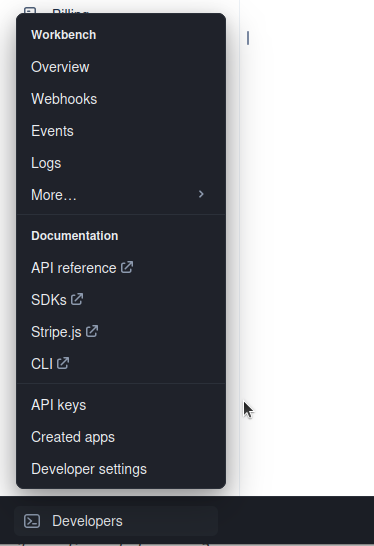
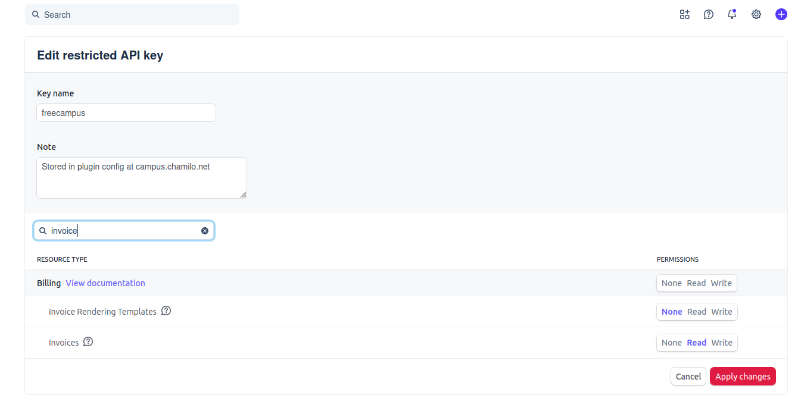

Buy Courses (course sales) plugin
=================================
This plugin transforms your Chamilo installation in an online shop by adding a catalogue
 of courses and sessions that you have previously configured for sales.

If the user is not registered or logged in, he/she will be requested to register/login
before he/she can resume buying items.

Do not enable this plugin in any "Region". This is a known issue, but it works without
region assignation.

Once the course or session is chosen, the plugin displays the available payment methods
and lets the user proceed with the purchase.
Currently, the plugin allows users to pay through:
 - PayPal (requires a merchant account on PayPal at configuration time)
 - Bank payments (requires manual confirmation of payments' reception)
 - RedSys payments (Spanish payment gateway) (requires the download of an external file)
 - Stripe payments (requieres a merchant account oin Stripe at configuration time)
 - Cecabank payments (Spanish payment gateway)

The user receives an e-mail confirming the purchase and she/he can immediately
access to the course or session.

We recommend using sessions as this gives you more time-related availability options
(in the session configuration).

Updates
=========

You must load the update.php script for installations that were in
production before updating the code, as it will update the database structure to
enable new features.

Please note that updating Chamilo does *NOT* automatically update the plugins
structure.

You can find a history of changes in the [CHANGELOG.md file](../../plugin/BuyCourses/CHANGELOG.md)

Recurring services, webhooks and cron
=====================================

Stripe handles recurring card charges automatically through its own subscription
system. Chamilo does not initiate the recurring charge from a cron job.

For Stripe recurring services, configure the Stripe webhook endpoint to point to:

```text
https://YOUR-CHAMILO-DOMAIN/plugin/BuyCourses/src/stripe_response.php
```

The webhook must receive at least these events for service subscriptions:

- `checkout.session.completed`
- `invoice.paid`
- `invoice.payment_failed`
- `customer.subscription.updated`
- `customer.subscription.deleted`

When Stripe sends `invoice.paid`, Chamilo extends the service validity, updates
service benefits and records the recurring payment audit entry.
`customer.subscription.updated` keeps cancellation-at-period-end, restoration,
subscription status and the current paid period synchronized even when the change
was initiated directly in Stripe. `invoice.payment_failed` and
`customer.subscription.deleted` update the local recurring subscription status
accordingly.

Stripe restricted API key permissions
-------------------------------------

If BuyCourses is configured with a Stripe restricted API key (`rk_live_...` or
`rk_test_...`), the recurring-payment reconciliation needs **Invoices: Read**
(`invoice_read`) permission. Without it, Stripe can still charge the customer but
Chamilo cannot list the paid invoices needed to rebuild historical payment
history, calculate **Total collected**, or refresh stale recurring-service dates.

In the Stripe Dashboard:

1. Open **Developers → API keys**.
2. Edit the restricted key used by BuyCourses.
3. Search for **Invoices**.
4. Set **Invoices** to **Read**.
5. Click **Apply changes**.





Changing the permission does not require replacing the key in Chamilo. The same
restricted key can continue to be used after its permissions are updated.

A typical missing-permission error contains:

```text
Permission denied. Enabling Invoices Read ('invoice_read') permissions on this key would allow this request to continue.
```

PayPal recurring payments are updated through the PayPal IPN endpoint configured
for the plugin.

As a safety fallback, configure the recurring subscription processor to run once
per day from the Chamilo project root. This command does not charge the customer;
it only reconciles expired or renewed BuyCourses recurring service subscriptions
and applies the local course closing/reactivation rules when needed.

Test it first with:

```bash
php bin/console chamilo:buycourses:process-recurring-subscriptions --env=prod --dry-run
```

Example daily cron entry:

```cron
15 2 * * * cd /var/www/chamilo && /usr/bin/php bin/console chamilo:buycourses:process-recurring-subscriptions --env=prod >> var/log/buycourses-recurring.log 2>&1
```

Adjust `/var/www/chamilo` and `/usr/bin/php` to match your installation.

Design note: refunds vs. cancellations
=======================================

As of this writing, a sale can only reach "Cancelled" status *before* it is
completed (an abandoned checkout, a declined payment, an admin voiding a still-pending
manual bank transfer, etc.). There is no feature to cancel or refund a sale that has
already completed. Because invoices and receipts are only generated at the moment a
sale completes, a cancelled sale never had one to begin with — so hiding receipt/invoice
access for cancelled sales (`BuyCoursesPlugin::canUserAccessInvoice()`) is correct today:
there is nothing to hide, since nothing was ever issued.

If a genuine refund feature (voiding a sale *after* completion) is ever added, do **not**
extend that same "hide it" behaviour to refunded sales. At that point a real invoice or
receipt already exists for money that really was received, and:

- **Invoices** are legal, sequentially-numbered fiscal documents. They must stay fully
  accessible even after a refund — the correct accounting mechanism is a **credit note**
  (a new, separately-numbered document referencing and cancelling out the original), not
  hiding or deleting the original. The buyer may also need the original for their own
  bookkeeping regardless of the refund.
- **Receipts** are not fiscal documents, so there's more latitude, but they should stay
  accessible too, with the sale's status shown as "Refunded" rather than the document
  being hidden or watermarked as invalid — the payment genuinely happened; only its
  outcome changed later.
